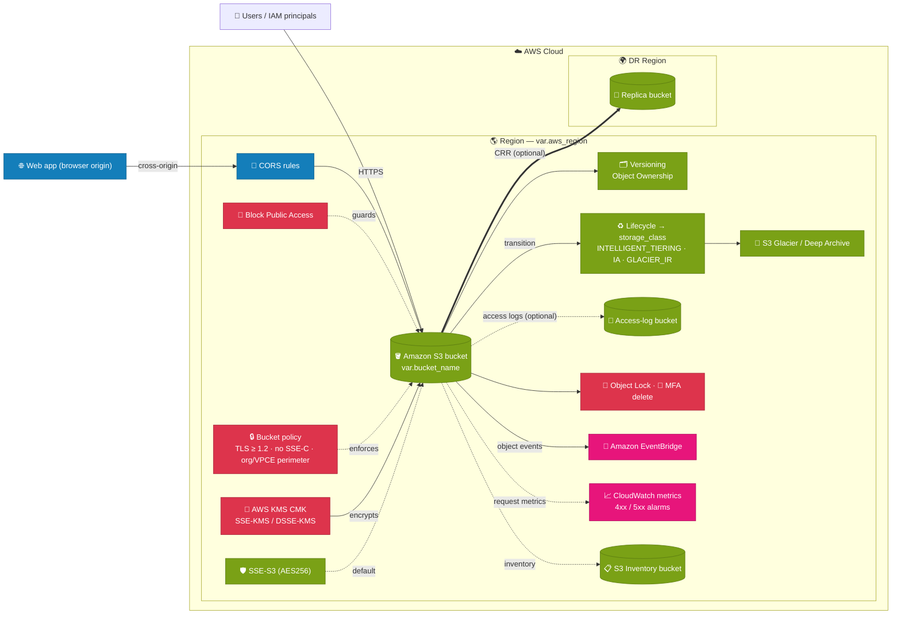
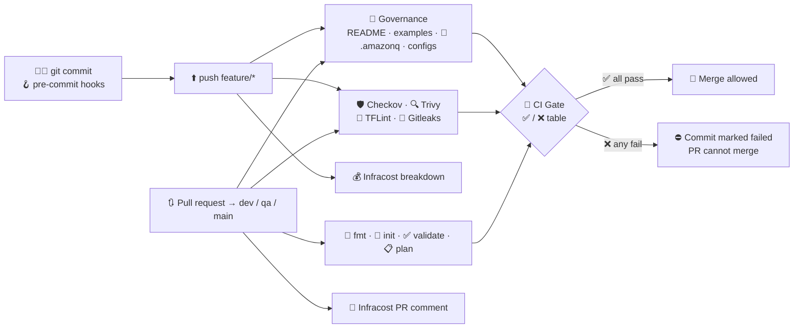

# 🪣 terraform-aws-s3-module

Terraform module that creates a secure-by-default **Amazon S3 bucket**. You choose the storage class, AWS region, Block Public Access, default encryption (SSE-S3, SSE-KMS or DSSE-KMS) and CORS. The repository includes a reusable GitHub Actions CI gate (Checkov, Trivy, TFLint, Gitleaks, terraform fmt/init/validate/plan) and Infracost cost estimates.

| | |
|---|---|
| **Terraform** | `>= 1.9.0` (cross-variable validation) |
| **AWS provider** | `>= 6.0` (resource-level `region` argument) |
| **Resources** | `aws_s3_bucket`, `_ownership_controls`, `_public_access_block`, `_versioning`, `_object_lock_configuration`, `_server_side_encryption_configuration`, `_cors_configuration`, `_lifecycle_configuration`, `_intelligent_tiering_configuration`, `_logging`, `_policy`, `_notification`, `_metric`, `_inventory`, `_replication_configuration`, `_accelerate_configuration`, `_request_payment_configuration`, `aws_kms_key`, `aws_kms_alias`, `aws_iam_role`, `aws_iam_role_policy`, `aws_cloudwatch_metric_alarm` |

---

## ✨ Features

| | Feature | Default |
|---|---|---|
| 🌎 | **Region per bucket** through the AWS provider v6 `region` argument, so you don't need a provider alias | required input |
| 🗄️ | **Storage class**: STANDARD, INTELLIGENT_TIERING, STANDARD_IA, ONEZONE_IA, GLACIER_IR, GLACIER, DEEP_ARCHIVE (applied with a lifecycle transition) | required input |
| 🚫 | **S3 Block Public Access**, with all four flags configurable | required input (all flags `true`) |
| 🔐 | **Default encryption**: SSE-S3 (AES256), SSE-KMS or DSSE-KMS. If you don't pass a key, the module creates a CMK with rotation enabled | required input |
| 🔀 | **CORS**, with validated rules | required input |
| 🔒 | **TLS-only bucket policy** that denies non-HTTPS requests and TLS older than 1.2 | `true` |
| 🗂️ | Versioning and `BucketOwnerEnforced` (ACLs disabled) | on / on |
| 🔑 | **MFA delete**: permanently deleting a version, or changing versioning, needs the root user's MFA code | off (root only) |
| 🧷 | **Object Lock** (WORM) with a default GOVERNANCE or COMPLIANCE retention period | off |
| ⛔ | Bucket policy denies **SSE-C** uploads and uploads that name a **different KMS key** | on |
| 🏢 | **Data perimeter**: allow only your AWS Organization and/or specific VPC endpoints | off |
| 🔁 | **Replication** (cross-region, same-region or cross-account) with a least-privilege IAM role, KMS replica key and optional Replication Time Control | off |
| ♻️ | Lifecycle: abort incomplete multipart uploads, move noncurrent versions to a cheaper class, expire noncurrent versions, optional expiration | 7 d / off / 90 d / off |
| 📜 | Server access logging with date-partitioned keys | off |
| 📣 | All object events sent to **Amazon EventBridge** | on |
| 📈 | CloudWatch **request metrics** and **4xx/5xx alarms** | off |
| 📋 | **S3 Inventory** reports (Parquet) for encryption, replication and Object Lock audits | off |
| 🚀 | **Transfer Acceleration** and **Requester Pays** | off |
| 🏷️ | Mandatory tags: Name, Environment, Project, Owner, Email, ManagedBy | always |

---

## 🏛️ AWS Well-Architected mapping

| Pillar | What the module does | Inputs |
|---|---|---|
| 🔐 **Security** | Block Public Access; ACLs disabled; default encryption with a rotating CMK; TLS-only (≥ 1.2) policy; SSE-C denied; wrong KMS key denied; Organization and VPC-endpoint perimeter; MFA delete; Object Lock | `enable_public_access_block`, `encryption_type`, `enforce_tls`, `deny_ssec_uploads`, `enforce_bucket_kms_key`, `allowed_organization_id`, `allowed_vpc_endpoint_ids`, `enable_mfa_delete`, `object_lock_*` |
| 🛟 **Reliability** | Versioning; cross-region replication with a 15-minute RTC SLA; delete markers not replicated by default (replicas stay protected); `force_destroy = false` | `enable_versioning`, `enable_replication`, `replication_*` |
| ⚙️ **Operational Excellence** | Mandatory tags; EventBridge events; request metrics with 4xx/5xx alarms; partitioned access logs; S3 Inventory; CI quality gates | `tags`, `enable_eventbridge_notifications`, `enable_request_metrics`, `create_cloudwatch_alarms`, `enable_access_logging`, `enable_inventory` |
| 💰 **Cost Optimization** | Storage-class transitions and Intelligent-Tiering archive tiers; noncurrent version tiering and expiration; abort incomplete uploads; S3 Bucket Keys; Requester Pays; Infracost on every PR | `storage_class`, `noncurrent_version_*`, `abort_incomplete_multipart_upload_days`, `bucket_key_enabled`, `enable_requester_pays` |
| ⚡ **Performance Efficiency** | Transfer Acceleration; regional placement close to consumers | `enable_transfer_acceleration`, `aws_region` |
| 🌱 **Sustainability** | Lifecycle rules delete or archive data nobody needs; Intelligent-Tiering moves cold data automatically | `object_expiration_days`, `noncurrent_version_expiration_days`, `enable_intelligent_tiering_archive` |

**Your responsibility (account or organization level, outside this module):** CloudTrail S3 data events, Amazon GuardDuty S3 Protection, Amazon Macie, AWS Config rules, S3 Storage Lens, and account-level Block Public Access.

---

## 🏗️ Architecture

> The full AWS-icon diagram is in [`docs/architecture.drawio`](docs/architecture.drawio). Open it with [diagrams.net](https://app.diagrams.net) or the VS Code *Draw.io Integration* extension.



### 🔁 CI/CD pipeline



---

## 🚀 Usage

```hcl
module "s3_bucket" {
  source = "git::https://github.com/<org>/terraform-aws-s3-module.git?ref=v1.0.0"

  # Mandatory
  bucket_name                = "acme-analytics-raw-prod"
  aws_region                 = "us-east-1"
  storage_class              = "INTELLIGENT_TIERING"
  enable_public_access_block = true
  encryption_type            = "SSE-KMS" # SSE-S3 | SSE-KMS | DSSE-KMS
  enable_cors                = true
  environment                = "prod"
  project                    = "analytics"
  owner                      = "data-platform"
  email                      = "data-platform@acme.com"

  # Optional
  storage_class_transition_days = 0
  cors_rules = [{
    allowed_methods = ["GET", "HEAD"]
    allowed_origins = ["https://app.acme.com"]
  }]
}
```

You'll find a complete, runnable example in [`examples/`](examples/). CI uses the same example for `terraform plan` and Infracost.

---

## 📥 Mandatory inputs

| Name | Type | Description | Validation |
|---|---|---|---|
| `bucket_name` | `string` | Globally unique S3 bucket name. | 3–63 chars, `[a-z0-9.-]`, starts and ends with a letter or digit, no `..`/`.-`/`-.`, not an IP address, no AWS-reserved prefixes or suffixes |
| `aws_region` | `string` | Region for the bucket and every related resource. | Valid region code, for example `us-east-1` or `us-gov-west-1` |
| `storage_class` | `string` | Target storage class. Any value other than `STANDARD` adds a lifecycle transition. | `STANDARD`, `INTELLIGENT_TIERING`, `STANDARD_IA`, `ONEZONE_IA`, `GLACIER_IR`, `GLACIER`, `DEEP_ARCHIVE` |
| `enable_public_access_block` | `bool` | Attach S3 Block Public Access. | — |
| `encryption_type` | `string` | Default server-side encryption. | `SSE-S3`, `SSE-KMS`, `DSSE-KMS` |
| `enable_cors` | `bool` | Apply a CORS configuration. | When `true`, `cors_rules` can't be empty |
| `environment` | `string` | Environment tag. | `dev`, `qa`, `uat`, `stage`, `prod`, `sandbox` |
| `project` | `string` | Project tag. | 1–64 chars |
| `owner` | `string` | Owner tag. | 1–64 chars |
| `email` | `string` | Owner contact email tag. | Valid email address |

## ⚙️ Optional inputs

| Name | Type | Default | Description | Validation |
|---|---|---|---|---|
| `tags` | `map(string)` | `{}` | Extra tags. The mandatory tags take precedence. | ≤ 40 entries; key 1–128 chars, can't start with `aws:`; value ≤ 256 chars |
| `storage_class_transition_days` | `number` | `30` | Days before objects move to `storage_class`. | Whole number from 0 to 3650; ≥ 30 for `STANDARD_IA`/`ONEZONE_IA` |
| `enable_intelligent_tiering_archive` | `bool` | `false` | Turn on the Archive and Deep Archive tiers (INTELLIGENT_TIERING only). | — |
| `intelligent_tiering_archive_days` | `number` | `90` | Days before the Archive Access tier. | 90–730 |
| `intelligent_tiering_deep_archive_days` | `number` | `180` | Days before the Deep Archive Access tier. | 180–730 and greater than the archive days |
| `abort_incomplete_multipart_upload_days` | `number` | `7` | Abort incomplete multipart uploads after this many days. | 1–365 |
| `noncurrent_version_expiration_days` | `number` | `90` | Delete noncurrent versions after this many days. `null` keeps them. | `null` or 1–3650 |
| `object_expiration_days` | `number` | `null` | Expire current objects after this many days. | `null` or 1–36500; must be greater than the transition days |
| `block_public_acls` | `bool` | `true` | Reject public ACLs. | — |
| `block_public_policy` | `bool` | `true` | Reject public bucket policies. | — |
| `ignore_public_acls` | `bool` | `true` | Ignore public ACLs. | — |
| `restrict_public_buckets` | `bool` | `true` | Restrict buckets that have public policies. | — |
| `kms_key_arn` | `string` | `null` | Existing KMS key for SSE-KMS/DSSE-KMS. When `null`, the module creates a CMK. | KMS key/alias ARN; must be `null` for SSE-S3 |
| `kms_key_deletion_window_in_days` | `number` | `30` | Deletion window for the module-created CMK. | 7–30 |
| `kms_key_administrator_arns` | `list(string)` | `[]` | IAM principals that get key-administration rights. | IAM role or user ARNs |
| `bucket_key_enabled` | `bool` | `true` | Use S3 Bucket Keys (SSE-KMS only). | — |
| `cors_rules` | `list(object)` | `[]` | CORS rules: `allowed_methods`, `allowed_origins`, and optionally `allowed_headers`, `expose_headers`, `max_age_seconds` (default 3000) and `id`. | ≤ 100 rules; methods GET/PUT/POST/DELETE/HEAD; origins `*` or `https://host`; max age 0–86400 |
| `enable_versioning` | `bool` | `true` | Turn on object versioning. | — |
| `object_ownership` | `string` | `"BucketOwnerEnforced"` | Object ownership mode. | `BucketOwnerEnforced`, `BucketOwnerPreferred`, `ObjectWriter` |
| `force_destroy` | `bool` | `false` | Let Terraform delete a bucket that still has objects. | — |
| `object_lock_enabled` | `bool` | `false` | Turn on Object Lock (WORM). | Requires `enable_versioning = true` |
| `enforce_tls` | `bool` | `true` | Add a policy that denies non-HTTPS requests and outdated TLS. | — |
| `minimum_tls_version` | `string` | `"1.2"` | Minimum TLS version. | `1.2` or `1.3` |
| `additional_bucket_policy_json` | `string` | `null` | Extra policy JSON, merged into the bucket policy. | Valid JSON |
| `enable_access_logging` | `bool` | `false` | Turn on server access logging. | — |
| `logging_target_bucket` | `string` | `null` | Bucket that receives the logs. | Valid bucket name; required when logging is on; can't be the source bucket |
| `logging_target_prefix` | `string` | `"s3-access-logs/"` | Key prefix for log objects. | ≤ 512 chars, no leading `/` |

| `enable_mfa_delete` | `bool` | `false` | Require MFA to permanently delete versions or change versioning. **Only the root user can turn this on.** | Requires `enable_versioning` and `mfa` |
| `mfa` | `string` (sensitive) | `null` | `"<root-mfa-serial-or-arn> <6-digit-code>"`. Pass it at apply time with `TF_VAR_mfa`. | Format `<serial> <6 digits>`; required when MFA delete is on |
| `object_lock_default_retention_mode` | `string` | `null` | Default retention mode for new objects. | `GOVERNANCE`, `COMPLIANCE` or `null`; requires `object_lock_enabled` |
| `object_lock_default_retention_days` | `number` | `null` | Default retention in days. | 1–36500; set exactly one of days or years |
| `object_lock_default_retention_years` | `number` | `null` | Default retention in years. | 1–100 |
| `noncurrent_version_transition_days` | `number` | `null` | Days before noncurrent versions move to a cheaper class. | 1–3650; ≥ 30 for IA classes; less than the expiration days |
| `noncurrent_version_transition_storage_class` | `string` | `"GLACIER_IR"` | Target class for noncurrent versions. | `STANDARD_IA`, `ONEZONE_IA`, `INTELLIGENT_TIERING`, `GLACIER_IR`, `GLACIER`, `DEEP_ARCHIVE` |
| `deny_ssec_uploads` | `bool` | `true` | Deny uploads that use customer-provided keys (SSE-C). | — |
| `enforce_bucket_kms_key` | `bool` | `true` | Deny uploads that name a KMS key other than the bucket's key (KMS only). | — |
| `allowed_organization_id` | `string` | `null` | Deny principals outside this AWS Organization. AWS services are exempt. | `o-` followed by 10–32 chars |
| `allowed_vpc_endpoint_ids` | `list(string)` | `[]` | Deny requests that don't come through these VPC endpoints. | `vpce-` IDs |
| `vpce_policy_exempt_principal_arns` | `list(string)` | `[]` | Principals exempt from the VPC-endpoint rule (deployment or break-glass roles). The replication role is always exempt. | IAM or STS ARNs |
| `logging_partitioned_prefix` | `bool` | `true` | Write access logs under date-partitioned keys. | — |
| `enable_eventbridge_notifications` | `bool` | `true` | Send object events to EventBridge. | — |
| `enable_request_metrics` | `bool` | `false` | Turn on CloudWatch request metrics (`EntireBucket` filter). | — |
| `create_cloudwatch_alarms` | `bool` | `false` | Create 4xxErrors and 5xxErrors alarms. | Requires `enable_request_metrics` |
| `alarm_actions` | `list(string)` | `[]` | SNS topics (or other ARNs) notified on ALARM and OK. | Valid ARNs |
| `alarm_5xx_errors_threshold` | `number` | `5` | 5xx error count per period that triggers the alarm. | ≥ 0 |
| `alarm_4xx_errors_threshold` | `number` | `100` | 4xx error count per period that triggers the alarm. | ≥ 0 |
| `alarm_period_seconds` | `number` | `300` | Alarm period. | 60, 300, 900 or 3600 |
| `alarm_evaluation_periods` | `number` | `1` | Periods that must breach before the alarm fires. | 1–24 |
| `enable_inventory` | `bool` | `false` | Turn on S3 Inventory. | — |
| `inventory_destination_bucket_arn` | `string` | `null` | Bucket that receives the reports. | S3 bucket ARN; required when inventory is on |
| `inventory_frequency` | `string` | `"Weekly"` | How often reports are produced. | `Daily` or `Weekly` |
| `inventory_format` | `string` | `"Parquet"` | Report format. | `CSV`, `ORC` or `Parquet` |
| `inventory_optional_fields` | `list(string)` | security and audit fields | Extra metadata columns in the report. | Supported S3 Inventory field names |
| `enable_replication` | `bool` | `false` | Replicate the whole bucket. | Requires `enable_versioning` |
| `replication_destination_bucket_arn` | `string` | `null` | Destination bucket, which must have versioning on. | S3 ARN; required when replication is on |
| `replication_role_arn` | `string` | `null` | Existing replication role. When `null`, the module creates a least-privilege role. | IAM role ARN |
| `replication_storage_class` | `string` | `"STANDARD"` | Storage class for replicas. | S3 storage classes |
| `replication_destination_kms_key_arn` | `string` | `null` | KMS key in the destination region. | KMS key ARN; required for SSE-KMS/DSSE-KMS sources |
| `replication_destination_account_id` | `string` | `null` | Destination account for cross-account replication. Replicas become owned by that account. | 12 digits |
| `replication_replicate_delete_markers` | `bool` | `false` | Replicate delete markers. | — |
| `replication_time_control` | `bool` | `false` | Turn on Replication Time Control (15-minute SLA) and replication metrics. | — |
| `enable_transfer_acceleration` | `bool` | `false` | Turn on S3 Transfer Acceleration. | Bucket name can't contain dots |
| `enable_requester_pays` | `bool` | `false` | Requesters pay for requests and data transfer. | — |

## 📤 Outputs

| Name | Description |
|---|---|
| `bucket_id` | Name (ID) of the bucket |
| `bucket_arn` | ARN of the bucket |
| `bucket_domain_name` | `<bucket>.s3.amazonaws.com` |
| `bucket_regional_domain_name` | `<bucket>.s3.<region>.amazonaws.com`, for example as a CloudFront origin |
| `bucket_hosted_zone_id` | Route 53 hosted zone ID for the bucket's region |
| `bucket_region` | Region the bucket was created in |
| `storage_class` | Target storage class |
| `encryption_type` | `SSE-S3`, `SSE-KMS` or `DSSE-KMS` |
| `sse_algorithm` | `AES256`, `aws:kms` or `aws:kms:dsse` |
| `kms_key_arn` | KMS key in use (`null` for SSE-S3) |
| `kms_key_alias` | Alias of the module-created CMK (`null` if no CMK was created) |
| `versioning_status` | `Enabled` or `Suspended` |
| `public_access_block_enabled` | Whether Block Public Access is attached |
| `cors_enabled` | Whether CORS is configured |
| `bucket_policy_json` | Bucket policy JSON (`null` if no policy is attached) |
| `tags` | All tags on the bucket, including provider default tags |
| `mfa_delete_enabled` | Whether MFA delete is on |
| `object_lock_enabled` | Whether Object Lock is on |
| `object_lock_default_retention` | `{mode, days, years}`, or `null` |
| `lifecycle_rule_ids` | IDs of the lifecycle rules in effect |
| `replication_enabled` | Whether replication is configured |
| `replication_role_arn` | Replication IAM role (`null` when replication is off) |
| `eventbridge_notifications_enabled` | Whether EventBridge notifications are on |
| `cloudwatch_alarm_arns` | Map of `4xx-errors` and `5xx-errors` to alarm ARNs |
| `inventory_configuration_name` | Inventory configuration name, or `null` |
| `transfer_acceleration_endpoint` | `<bucket>.s3-accelerate.amazonaws.com`, or `null` |

---

## 🛡️ CI/CD quality gates

| Workflow | Trigger | Purpose |
|---|---|---|
| [`.github/workflows/reusable-iac-ci.yml`](.github/workflows/reusable-iac-ci.yml) | `workflow_call` | Reusable gate. It installs Checkov, Trivy, TFLint and Gitleaks on the runner, runs every check and publishes the ✅/❌ table |
| [`.github/workflows/ci.yml`](.github/workflows/ci.yml) | push to any branch except `dev`/`qa`/`main`; PR into `dev`/`qa`/`main` | Calls the reusable gate |
| [`.github/workflows/infracost.yml`](.github/workflows/infracost.yml) | push to a feature branch; PR into `dev`/`qa`/`main`; `workflow_call` | Cost breakdown in the job summary on push; cost diff posted as a PR comment |

| # | Gate | Push | PR |
|:-:|---|:-:|:-:|
| 3 | 🛡️ Checkov · 🔍 Trivy · 🧹 TFLint · 🔐 Gitleaks | ✅ | ✅ |
| 4 | 🧪 `examples/main.tf`, `variables.tf`, `outputs.tf`, `README.md` exist | ✅ | ✅ |
| 5 | 📘 `README.md` exists in the module root | ✅ | ✅ |
| 6 | 🤖 `.amazonq/rules/*.md` exists | ✅ | ✅ |
| 7 | ⚙️ `.pre-commit-config.yaml`, `.tflint.hcl`, `trivy.yaml` exist | ✅ | ✅ |
| 10 | 🎨 fmt · 🚀 init · ✅ validate · 📋 plan | — | ✅ |

The **🚦 CI Gate** job combines every result into one table. The table goes to the job summary, to the PR as a sticky comment, and to the log in ANSI green/red. If any gate fails, the job fails.

### What "the commit will fail" means on GitHub
GitHub can't reject a `git push` because a workflow failed. The module enforces the rules in three layers instead:
1. **Locally, before the commit exists:** the `pre-commit` and `pre-push` hooks run the same scanners plus `scripts/check-module-structure.sh`. If any check fails, the commit or push is aborted.
2. **On the feature-branch push:** the `IaC CI / CI Gate` check fails and the commit shows a red ❌.
3. **On the PR:** a repository ruleset marks `IaC CI / CI Gate` as a required check on `dev`, `qa` and `main`, so the PR **can't be merged** until every gate passes.

### One-time repository setup
```bash
# 1. Secrets (Settings → Secrets and variables → Actions)
#    AWS_ROLE_ARN       IAM role trusted for GitHub OIDC (read-only is enough for plan)
#    ROLE_SESSION_NAME  optional
#    INFRACOST_API_KEY  from `infracost auth login`

# 2. Make the CI gate a required check on dev / qa / main (needs repo admin)
scripts/configure-branch-protection.sh <owner>/<repo>

# 3. Developer workstation
pip install pre-commit checkov
brew install terraform tflint trivy
pre-commit install --install-hooks
```

---

## 🧪 Testing

```bash
terraform init -backend=false
terraform test   # offline: the AWS provider is mocked in tests/s3_bucket.tftest.hcl
```

## 📂 Repository layout

```
terraform-aws-s3-module/
├── main.tf              bucket, versioning/MFA delete, Object Lock, encryption, CORS, acceleration
├── kms.tf · policy.tf   CMK · bucket policy guardrails
├── lifecycle.tf         storage-class transitions, noncurrent tiering, Intelligent-Tiering
├── replication.tf       CRR/SRR + least-privilege IAM role
├── observability.tf     access logs, EventBridge, metrics, alarms, inventory
├── variables.tf · outputs.tf · versions.tf
├── examples/              main.tf · variables.tf · outputs.tf · README.md
├── tests/                 s3_bucket.tftest.hcl
├── docs/                  architecture.drawio
├── scripts/               check-module-structure.sh · configure-branch-protection.sh
├── .amazonq/rules/        s3-security.md · terraform-standards.md · cost-and-operations.md
├── .github/workflows/     reusable-iac-ci.yml · ci.yml · infracost.yml
├── .pre-commit-config.yaml · .tflint.hcl · trivy.yaml · .trivyignore
├── .checkov.yaml · .gitleaks.toml · infracost-usage.yml
└── README.md · LICENSE
```

## 📌 Notes
- Bucket names are global. The S3 namespace doesn't depend on `aws_region`.
- Accepted scanner exceptions are documented next to each one: inline `#checkov:skip` comments in `main.tf`, and `.trivyignore`. The exceptions are cross-region replication, event notifications, optional access logging and optional SSE-S3.
- `ONEZONE_IA` keeps data in a single AZ. Don't use it for the only copy of critical data.
- **MFA delete:** AWS only accepts this from the **root user** with its MFA device. Apply once with root credentials, for example `TF_VAR_mfa="arn:aws:iam::<acct>:mfa/root-account-mfa-device 123456" terraform apply`. Because the code changes every 30 seconds, apply MFA-delete changes on their own. To turn MFA delete off later, the root user must also do it.
- **Object Lock** can only be turned on when the bucket is created. `COMPLIANCE` retention can't be shortened by anyone, including root. Try `GOVERNANCE` first.
- **VPC-endpoint perimeter:** add your deployment and break-glass roles to `vpce_policy_exempt_principal_arns` before you turn it on, or you can lock yourself out of the bucket.
- **Replication:** the destination bucket must already exist with versioning on. For cross-account replication, its bucket policy must allow the replication role.

## 📄 License
MIT. See [LICENSE](LICENSE).
